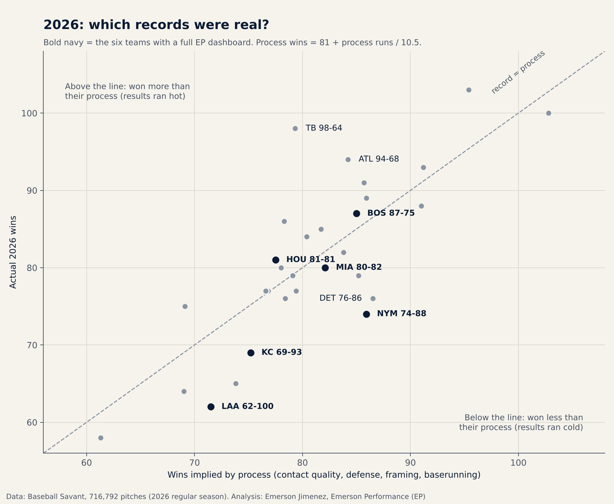
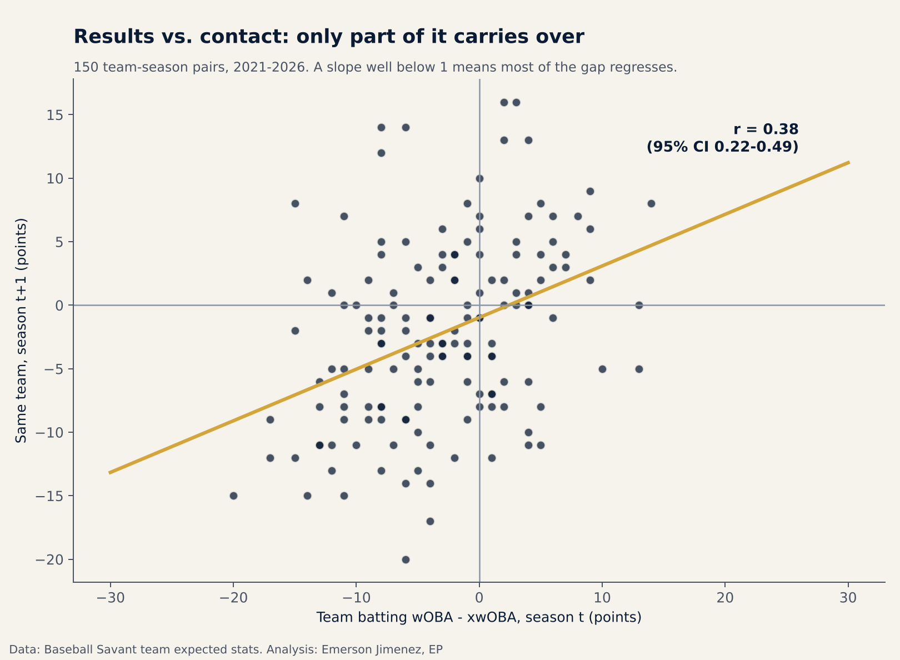
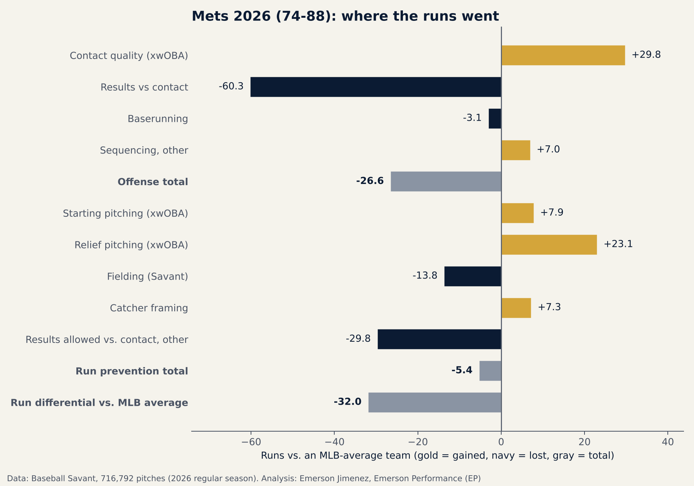

# EP Team Diagnosis 2026

**Which 2026 records were real?** This repo splits every MLB team's 2026 run differential into **process** (contact quality on both sides, fielding, framing, baserunning) and **results** (what happened beyond the quality of contact), from all 716,792 regular-season pitches. The Mets' process was worth about **86 wins**; they won **74**. The Rays' process was worth about **79 wins**; they won **98**.

*English first · [Español abajo](#español)*



| Result | Numbers | Label |
|---|---|---|
| Team results vs. contact (wOBA − xwOBA) carries over only partly from one season to the next | r = 0.38 (95% CI 0.22–0.49), 150 team-season pairs, 2021–2026 | **CONFIRMED** |
| Teams 10+ points below their contact quality move back toward it the next season | 25 teams: gap −.013 → −.007; wOBA +.007 the next season | CONFIRMED |
| 2026 records furthest **below** process | Mets −11.9 wins (74 vs 85.9), Tigers −10.5, Angels −9.5, Giants −8.8 | CONFIRMED (descriptive) |
| 2026 records furthest **above** process | Rays +18.7 wins (98 vs 79.3), Braves +9.8, D-backs +7.7, Brewers +7.6 | CONFIRMED (descriptive) |
| Expect the cold teams to gain and the hot teams to give back part of the gap in 2027 | Based on r = 0.38: most of a results gap does not repeat | INTERPRETATION |

**Front-office question:** *How much of our 2026 record was the roster, and how much was results that will not repeat? Should we rebuild, or hold?*

**Practical conclusion:** A team far below its process (Mets, Orioles, Phillies on offense) should not rebuild around 2026 results; most of that gap regresses. A team far above its process (the Rays overall; the Rays and Cubs on offense) should not pay for a repeat.

---

## What is in the repo

- **All 30 teams**, each with the same diagnosis: record and run differential, offense vs. MLB with ranks, first and second half, run prevention (starters, relievers, OAA and its splits, framing), run value by pitch type, times through the order for starters, and a run bridge. Files: [`outputs/<TEAM>_diagnosis.json`](outputs/), summary in [`outputs/league_summary.csv`](outputs/league_summary.csv).
- **The repeatability backtest** behind the conclusion: [`outputs/backtest.json`](outputs/backtest.json).
- **A validation against the six published EP dashboards** (Mets, Marlins, Royals, Red Sox, Astros, Angels): every number recomputed and compared, in [`validation/validation_report.csv`](validation/validation_report.csv).



### Example: the Mets' run bridge



The Mets hit the ball better than the league average (+29.8 runs from contact quality; 1st in MLB in exit velocity), but their results fell 60 runs short of that contact. Run prevention was close to average: good relief pitching and framing, offset by fielding (−23 OAA) and results allowed below contact quality.

---

## Validation against the published dashboards

The six team dashboards on [ejimenezperformance.github.io/mlb-2026](https://ejimenezperformance.github.io/mlb-2026/) were built before this repo existed. This repo rebuilds the method from public data and checks every number against them.

| Section | Matched | |
|---|---|---|
| Record, runs, one-run games, OAA | 60 / 60 | 100% |
| Run value by pitch type | 129 / 129 | 100% |
| Offense vs. MLB (values and ranks) | 157 / 162 | 97% |
| Run prevention (values and ranks) | 124 / 142 | 87% |
| Times through the order | 45 / 51 | 88% |
| First and second half | 21 / 24 | 88% |
| Run bridge (within 1.5 runs) | 31 / 72 | 43% |
| **Total** | **567 / 640** | **89%** |

"Matched" means equal at the precision published (one unit of rounding). Run bridge **totals** match exactly in all 18 cases; 68 of 72 bridge steps are within 3 runs.

**Why the rest differ (documented, not hidden):**
1. **The Mets dashboard was built first, with slightly different definitions** than the other five: fastball velocity included cutters, hard-hit rate used all balls in play, framing was not centered on the league average, and "third time through" included later times. This repo uses the definitions of the five later dashboards. Without the Mets, 490 of 544 numbers match (90%).
2. **Baserunning** could not be reproduced with one definition for all six teams. This repo uses all runners by team, relative to the league average. The difference moves into "Sequencing, other," so offense totals do not change.
3. **Ties in ranks:** where teams are tied, ranks can differ by one place.
4. **Pitching split-half correlation:** the batting value reproduces (odd vs. even games, r = 0.33); the pitching value does not (0.60 here vs. 0.53 published).

---

## Method

**Data.** Every 2026 regular-season pitch from Baseball Savant (716,792 pitches, 2,429 games, Mar 25–Sep 27), downloaded in 4-day windows; Savant leaderboards for team OAA, player fielding runs prevented, catcher framing and baserunning; Savant team expected stats 2021–2026. `src/pull_data.py` downloads everything; raw files are not committed.

**Core definitions.**
- wOBA uses Savant's event values; reaching on an error or a fielder's choice counts as an out (as in the official wOBA; the pitch-level `woba_value` column credits them as hits).
- xwOBA: Savant's speed/angle estimate on balls in play, event value otherwise.
- Starter = a team's first pitcher of each game. Fastball = four-seam and sinker.
- First half = games before the All-Star break (Jul 13–15, 2026, no games).
- Framing: each catcher's framing runs split across teams by the share of pitches he caught for each (handles trades), then centered on the league average.

**Run bridge.** Runs vs. an MLB-average team. Contact quality and pitching are converted from xwOBA with the 2026 runs-per-PA-on-wOBA slope across 30 teams (0.78). Results vs. contact = the team's wOBA − xwOBA gap minus the league gap. Fielding = player fielding runs prevented summed by team. Sequencing and "results allowed vs. contact, other" are residuals, so each side adds up to the actual runs.

**Process wins.** 81 + (contact quality + baserunning + starting and relief pitching + fielding + framing) / 10.5 runs per win. The same 10.5 reproduces the "run-differential wins" on all six dashboards.

**Backtest.** Year-to-year correlation of the team gap over 150 team-season pairs (2021–2026), with a team-clustered bootstrap CI (2,000 resamples).

**Language.** "Came with," not "caused." Process wins describe 2026; they are not a projection.

### Limitations

- One season of pitch-level data; the backtest uses team-level expected stats.
- xwOBA does not see batted-ball direction or runner speed; opposing defensive positioning is not measured.
- Results vs. contact is partly skill (r = 0.38 means about a third of it carries over), so "process wins" is not the same as true talent.
- Not included from the dashboards, because it does not come from Statcast: injuries, payroll, free-agent targets and the 2027 win projection.

## Reproduce

```bash
pip install -r requirements.txt
python src/pull_data.py          # ~90 Baseball Savant requests (about 30 minutes)
cd src
python report.py ALL             # 30 team diagnoses
python backtest.py
python league_summary.py
python validate.py               # compare with the six published dashboards
python charts.py
```

## Corrections log

None yet. Any correction will be listed here with the date and the files affected.

---

## Español

**¿Qué récords de 2026 fueron reales?** Este repo divide el diferencial de carreras de cada equipo de MLB en **proceso** (calidad de contacto de los dos lados, fildeo, framing y corrido de bases) y **resultados** (lo que pasó más allá de la calidad del contacto), con los 716,792 pitcheos de la temporada regular. El proceso de los Mets valía unas **86 victorias**; ganaron **74**. El de los Rays valía unas **79**; ganaron **98**.

| Resultado | Números | Etiqueta |
|---|---|---|
| Los resultados contra la calidad de contacto (wOBA − xwOBA) se repiten solo en parte de una temporada a otra | r = 0.38 (IC 95%: 0.22–0.49), 150 pares equipo-temporada, 2021–2026 | **CONFIRMED** |
| Los equipos 10+ puntos por debajo de su calidad de contacto se acercan a ella al año siguiente | 25 equipos: brecha de −.013 a −.007; wOBA +.007 al año siguiente | CONFIRMED |
| Récords 2026 más **por debajo** del proceso | Mets −11.9 victorias (74 vs 85.9), Tigers −10.5, Angels −9.5, Giants −8.8 | CONFIRMED (descriptivo) |
| Récords 2026 más **por encima** del proceso | Rays +18.7 victorias (98 vs 79.3), Braves +9.8, D-backs +7.7, Brewers +7.6 | CONFIRMED (descriptivo) |
| Se espera que los equipos fríos recuperen y los calientes devuelvan parte de la brecha en 2027 | Por r = 0.38: la mayor parte de la brecha no se repite | INTERPRETATION |

**Pregunta de front office:** *¿Cuánto de nuestro récord de 2026 fue el roster y cuánto fueron resultados que no se van a repetir? ¿Reconstruir o mantener?*

**Conclusión práctica:** Un equipo muy por debajo de su proceso (Mets, Orioles, Phillies en ofensiva) no debería reconstruir por los resultados de 2026; la mayor parte de esa brecha regresa. Un equipo muy por encima de su proceso (los Rays en general; los Rays y los Cubs en ofensiva) no debería pagar como si fuera a repetirse.

### Qué incluye

- **Los 30 equipos** con el mismo diagnóstico: récord, ofensiva contra MLB con rankings, mitades, prevención de carreras (abridores, relevistas, OAA, framing), run value por tipo de pitcheo, times through the order y puente de carreras.
- **El backtest de repetibilidad** que sostiene la conclusión.
- **Una validación contra los seis dashboards publicados de EP:** cada cifra recalculada y comparada.

### Validación

**567 de 640 cifras publicadas (89%) se reproducen** a la precisión publicada: 100% del récord, carreras y OAA, 100% del run value por pitcheo y 97% de la ofensiva. Los totales del puente de carreras coinciden exacto en los 18 casos.

Por qué difiere el resto (documentado, no escondido):
1. **El dashboard de los Mets se hizo primero, con definiciones un poco distintas** a los otros cinco (la recta incluía el cutter, el hard-hit usaba todas las pelotas en juego, el framing no estaba centrado en el promedio y "tercera vez" incluía las siguientes). Este repo usa las definiciones de los cinco más recientes. Sin los Mets coinciden 490 de 544 (90%).
2. **Corrido de bases:** no se pudo reproducir con una sola definición para los seis equipos. La diferencia pasa a "Sequencing, other", así que el total ofensivo no cambia.
3. **Empates en rankings:** pueden variar en un puesto.
4. **Split-half de pitcheo:** el de bateo se reproduce (r = 0.33); el de pitcheo no (0.60 aquí vs 0.53 publicado).

### Método (resumen)

- **Datos:** todos los pitcheos de la temporada regular 2026 de Baseball Savant, leaderboards de OAA, fildeo, framing y corrido de bases, y estadísticas esperadas por equipo 2021–2026.
- **wOBA:** las llegadas por error o fielder's choice cuentan como out, como en el wOBA oficial.
- **Abridor** = el primer pitcher de cada juego. **Recta** = cuatro costuras y sinker. **Primera mitad** = antes del Juego de Estrellas.
- **Puente de carreras:** carreras contra un equipo promedio; calidad de contacto y pitcheo convertidos con la pendiente de carreras por PA sobre wOBA de 2026 (0.78).
- **Victorias de proceso:** 81 + carreras de proceso / 10.5.
- **Lenguaje:** "vino con", no "causó". Las victorias de proceso describen 2026; no son una proyección.

---

Analysis: Emerson Jimenez, Emerson Performance (EP) · [ejimenezperformance.github.io](https://ejimenezperformance.github.io)
Data: Baseball Savant / MLB Advanced Media. Not affiliated with MLB or any club.
